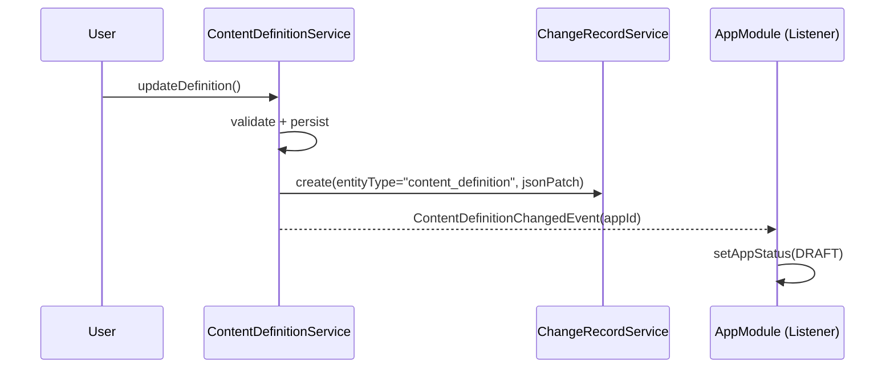
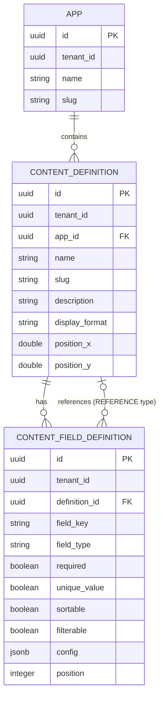

# Content Definition — Design Document

## 1. Overview

**What:** Content Definition enables tenant users to define custom content types within an App — with typed fields, validation rules, bidirectional relationships (REFERENCE + MIRROR fields), and a canvas-only visual graph editor with drag-and-connect, popovers, and undo/redo.

**Who:** Tenant users with `content_definition` permissions (viewer/editor/creator/deleter/admin). Managed via the App Detail Page.

**Why:** Core building block of the Low-Code platform. Without Content Definitions, no content can be created. The App Domain provides the container; Content Definition fills it with structure.

**Scope:**
- Content Definition CRUD (within an App)
- Field Definition Management (8 types incl. MIRROR, type-specific config, global options)
- Reference Field Validation (App-Dependency checks, 3 relation types)
- OpenFGA Permissions (fine-grained per definition, inherited from App)
- App Revision Integration (Definition revisions in App Revisions tab)
- Graph UI (React Flow canvas-only with drag-and-connect, popovers, spotlight search)

**Explicitly NOT in scope:**
- Content Management (Entries CRUD, EAV queries) — next phase
- Dedicated Table Migration — later
- Content Versioning — later
- Bulk Operations (Import/Export of entries) — later
- `storageStrategy` field — YAGNI, added when Dedicated Table is implemented

## 2. Functional Areas

### 2.1 Content Definition CRUD

**Function:** Create, Read, Update, Delete Content Definitions within an App. Slug is auto-generated and fixed after creation (name can change). Name must be unique per App (not per Tenant).

**State Changes:**
- Create: DB insert, App status → DRAFT, App revision created, OpenFGA tuples written
- Update: DB update, App status → DRAFT, App revision created
- Delete: DB delete (soft), Reference fields pointing to this definition are automatically removed (cascade, both same-app and cross-app), OpenFGA tuples removed

**Endpoints (in `content-api.yaml`):**
```
POST   /api/v1/content/{appSlug}/definitions                Create definition
GET    /api/v1/content/{appSlug}/definitions                List definitions
GET    /api/v1/content/{appSlug}/definitions/{definitionId}  Get definition detail
PUT    /api/v1/content/{appSlug}/definitions/{definitionId}  Update definition
DELETE /api/v1/content/{appSlug}/definitions/{definitionId}  Delete definition
GET    /api/v1/content/{appSlug}/definitions/name-available  Check name availability
```

**Model:**
```
ContentDefinition
  id: UUID (UUIDv7)
  tenantId: UUID
  appId: UUID (FK → apps)
  name: String (unique per App)
  slug: String (unique per App, fixed after creation)
  description: String
  displayFormat: String (template, e.g. "{title} — {author}")
  positionX: Double (graph canvas X position, nullable — null = auto-layout)
  positionY: Double (graph canvas Y position, nullable — null = auto-layout)
  fields: List<FieldDefinition>
  auditInfo: AuditInfo (createdAt, createdBy, updatedAt, updatedBy, deletedAt, deletedBy)
```

### 2.2 Field Definition Management

**Function:** Manage fields on a Content Definition. Add, Edit, Delete, Reorder. 7 Field Types with type-specific FieldConfig (JSONB). Global options on all fields. `fieldKey` is changeable after creation, `fieldType` is fixed.

**Field Types + Config:**

| Field Type | Config Options | Created via |
|---|---|---|
| TEXT | `minLength`, `maxLength`, `pattern` (regex), `defaultValue` | Popover on node |
| INTEGER | `min`, `max`, `defaultValue` | Popover on node |
| DECIMAL | `min`, `max`, `precision`, `scale`, `defaultValue` | Popover on node |
| BOOLEAN | `defaultValue` | Popover on node |
| DATE | `minDate`, `maxDate`, `dateFormat` (e.g. `yyyy-MM-dd`), `defaultValue` | Popover on node |
| ENUM | `allowedValues` (list of strings), `defaultValue` | Popover on node |
| REFERENCE | `targetDefinitionId`, `relationType` (ONE_TO_ONE / MANY_TO_ONE / MANY_TO_MANY), `onDelete` (CASCADE / SET_NULL / RESTRICT) | **Drag-and-Connect on graph only** (not in field type dropdown) |
| MIRROR | `sourceDefinitionId`, `sourceFieldId`, `ownerAppId` | **Auto-created** when REFERENCE field is created (inverse/readonly) |

**Note:** REFERENCE fields are exclusively created by dragging a connection line between two definition nodes on the graph canvas. The field type dropdown in the "Add Field" popover only shows 6 types (TEXT, INTEGER, DECIMAL, BOOLEAN, DATE, ENUM). REFERENCE fields are displayed on the node and editable via popover (relation type, onDelete), but cannot be created through the popover.

**MIRROR fields** are automatically created on the target definition when a REFERENCE field is created. They represent the inverse side of the relation and are always paired with their source REFERENCE field:
- Deleting a MIRROR field → deletes the source REFERENCE field (and vice versa)
- MIRROR fields are owned by the source app (`ownerAppId`), not by the app of the definition they appear on — this prevents circular dependencies for cross-app references
- The mirror fieldKey is entered by the user in the Connect Dialog, with an auto-generated plural of the source definition name as default value (e.g. source "Post" → default mirrorKey "posts")
- MIRROR fields are visually distinct on the node (e.g. italic, "↩" icon, virtual badge)
- MIRROR fields are read-only in terms of config — their config is derived from the source REFERENCE field
- Cross-app visibility: users without viewer permission on the source app do not see the MIRROR field

**Global Field Options (all types):**

| Option | Description |
|---|---|
| `required` | Entry must have this field set (enforced at Content Management phase) |
| `unique` | Value must be unique per definition (enforced at Content Management phase) |
| `sortable` | Field can be used as sort criteria (metadata for Content Management) |
| `filterable` | Field can be used as filter criteria (metadata for Content Management) |

Note: `required`, `unique`, `sortable`, `filterable` are stored as metadata on the FieldDefinition. Actual enforcement happens in the Content Management phase (Entries CRUD).

**Config Validation (strict, at create/update time):**
- `min` < `max` (INTEGER, DECIMAL)
- `minLength` < `maxLength` (TEXT)
- `minDate` < `maxDate` (DATE)
- `pattern` is a valid regex (TEXT)
- `precision` >= `scale` (DECIMAL)
- `allowedValues` is non-empty (ENUM)
- `defaultValue` matches type and constraints
- `targetDefinitionId` exists and is reachable (REFERENCE)
- `displayFormat` placeholders reference existing fieldKeys

**Endpoints:**
```
POST   /api/v1/content/{appSlug}/definitions/{definitionId}/fields              Add field
PUT    /api/v1/content/{appSlug}/definitions/{definitionId}/fields/{fieldId}     Update field
DELETE /api/v1/content/{appSlug}/definitions/{definitionId}/fields/{fieldId}     Delete field
PUT    /api/v1/content/{appSlug}/definitions/{definitionId}/fields/reorder       Reorder fields
```

**Model:**
```
FieldDefinition
  id: UUID (UUIDv7)
  tenantId: UUID
  definitionId: UUID (FK → content_definitions)
  fieldKey: String (unique per definition, changeable)
  fieldType: FieldType (fixed after creation)
  required: Boolean
  unique: Boolean
  sortable: Boolean
  filterable: Boolean
  config: FieldConfig (type-specific, JSONB)
  position: Integer (ordering)
```

**FieldConfig (sealed interface, polymorphic via fieldType):**
```java
sealed interface FieldConfig permits
    TextFieldConfig,
    IntegerFieldConfig,
    DecimalFieldConfig,
    BooleanFieldConfig,
    DateFieldConfig,
    EnumFieldConfig,
    ReferenceFieldConfig,
    MirrorFieldConfig
```

**MirrorFieldConfig:**
```
MirrorFieldConfig
  sourceDefinitionId: UUID (the definition that owns the REFERENCE field)
  sourceFieldId: UUID (the REFERENCE field this mirrors)
  ownerAppId: UUID (the app that owns the REFERENCE field — prevents cross-app circular deps)
```

### 2.3 Reference Field Validation & Auto-Dependency Management

**Rules:**
- Same-App reference: always allowed (including circular references between definitions)
- Cross-App reference: App Dependency is **automatically created** when user drags a ghost node onto the canvas (cycle detection still applies — if adding the dependency would create a cycle, the drop is rejected with an error)
- Cross-App references are always acyclic (guaranteed by App Dependency cycle detection)

**Auto-Dependency Lifecycle (graph-driven):**
- **Create:** When user drags a definition from another app onto the canvas via spotlight search → ghost node appears → App Dependency auto-created
- **Delete:** When user removes the last ghost node of a dependency app from the canvas (and no reference fields point to that app's definitions) → **Confirmation Dialog** ("Removing this will also delete the dependency on App X. Continue?") → on confirm: App Dependency auto-deleted
- The Dependencies tab on the App Detail Page becomes **read-only** (shows dependencies managed by the graph)
- Existing add/remove dependency UI components become dead code and are removed

**Relation Types:**
- `ONE_TO_ONE` — one entry references exactly one entry
- `MANY_TO_ONE` — multiple entries reference one entry
- `MANY_TO_MANY` — multiple entries reference multiple entries

**onDelete Strategies (enforced at Content Management phase):**
- `CASCADE` — deleting target entry deletes referencing entries
- `SET_NULL` — deleting target entry sets reference to null
- `RESTRICT` — deleting target entry is blocked if references exist

**Definition Delete Behavior:**
- When a definition is deleted, Reference fields in other definitions pointing to it are automatically removed (cascade in application layer)
- This applies uniformly for both same-app and cross-app references
- If a ghost node is removed and it was the last reference to that dependency app, the App Dependency is auto-deleted
- **Audit trail:** Cascade-removed reference fields are logged as App Revisions (ChangeRecord with `changeType="cascade_delete"`) so the auto-removal is traceable
- **Cross-app cascade:** Queries all definitions across apps that have reference fields to the deleted definition (uses FieldDefinition repository query on `targetDefinitionId` in config JSONB)

### 2.4 OpenFGA Permissions

**Pre-requisite: Add `creator` relation to `app_management` type.**
The current `app_management` only has admin/editor/viewer. A `creator` relation is needed
so that Content Definition creation can be permission-checked at the App level.
**Note:** This modifies an existing core type. Existing tuples remain valid — `creator` is additive.
The `viewer` relation is extended to include `creator` (viewers can see what they can create).
No tuple migration needed; existing roles continue to work unchanged.

```
type app_management
  relations
    ...existing...
    define creator: [user, role#assignee] or admin    # NEW
    define viewer: [user, role#assignee] or editor or creator  # updated
```

**New type `content_definition` in OpenFGA model (`model.fga`):**
```
type content_definition
  relations
    define parent: [app]
    define viewer: [user, role#assignee] or viewer from parent
    define editor: [user, role#assignee] or editor from parent
    define admin: [user, role#assignee] or admin from parent
    define creator: [user, role#assignee] or admin from parent
    define deleter: [user, role#assignee] or editor from parent
```

**Inheritance from App:**
- `app admin` → `content_definition admin` + `creator`
- `app editor` → `content_definition editor` + `deleter`
- `app viewer` → `content_definition viewer`

**Tuple Lifecycle:**
- Create definition: write tuple `content_definition:{id}#parent@app:{appId}`
- Delete definition: remove tuple

**Permission Checks:**
- Create definition: `app#creator` check (definition doesn't exist yet)
- Read definition: `content_definition#viewer`
- Update definition/fields: `content_definition#editor`
- Delete definition: `content_definition#deleter`
- Field CRUD: same permissions as the definition (fields are not a separate resource type)

**Permission Matrix UI:**
- Existing Role Detail Page extended with Content Definition permissions
- Hierarchical: expand App → see Definitions underneath → toggles per definition
- Dynamic: definitions are loaded per tenant/app

**Integration with existing services:**
- `RoleService.RESOURCE_ACTIONS`: extend with `content_definition` (viewer/editor/admin) — same pattern as `app_management`
- `AuthService.getEffectivePermissions()`: extend BatchCheck to include `content_definition` permissions
- `TenantProvisioningListener`: add `content_definition` default permissions to system roles (Editor gets editor, Viewer gets viewer)
- **Initial Tenant User:** The user created during tenant provisioning (initial admin) must receive full `content_definition` permissions (admin + creator + deleter) via the Admin role. This is inherited from `app_management#admin` → `content_definition#admin`/`creator`, but must be verified during provisioning.

### 2.5 App Revision Integration

**Approach:** Separate revision tracking per Content Definition using existing `ChangeRecordService` with JSON Patch diffs. Definition revisions appear in the App Revisions tab alongside App revisions.

**How it works:**
- Any change to a Content Definition or its fields → `ChangeRecordService.create()` with `entityType="content_definition"`, JSON Patch payload
- App status automatically set to DRAFT
- Revisions tab shows App + Content Definition revisions mixed, typed by `entityType` (icon/label distinguishes them)
- Manual revert per revision using inverse JSON Patch (same pattern as `AppRevisionService.computeReversePatch()`)

**Publish/Rollback Integration:**
- App Publish: all draft revisions cleared (App + Content Definition), current state of all definitions serialized into AppSnapshot
- App Rollback: Content Definitions restored from AppSnapshot state using reconciliation algorithm below

**Rollback Reconciliation Algorithm:**
When rolling back to a previous snapshot, the following strategy applies:
1. Load snapshot's `contentDefinitions` list (the "desired state")
2. Load current definitions from DB (the "actual state")
3. **Definitions in snapshot but not in DB:** Re-create them (soft-deleted → restore, hard-deleted → insert)
4. **Definitions in DB but not in snapshot:** Soft-delete them (they were added after the publish)
5. **Definitions in both:** Compare field-by-field, overwrite current state with snapshot state (name, description, displayFormat, all fields + configs)
6. **Reference fields pointing to definitions that don't exist after reconciliation:** Auto-remove (same cascade logic as definition delete)
7. **Ordering:** Process definitions without references first, then those with references (topological sort to avoid dangling refs during reconciliation)
8. **Transaction:** Entire reconciliation runs in a single transaction — all or nothing
9. **Post-reconciliation:** Clean up OpenFGA tuples (remove tuples for deleted definitions, add for restored ones)

**AppSnapshot Extension:**
The existing `AppSnapshot.contentDefinitions` field (with `AppSnapshotDefinition`) is extended to include full field details:
```
AppSnapshotDefinition (extended)
  name, slug, description, displayFormat
  fields: List<AppSnapshotField>
    fieldKey, fieldType, required, unique, sortable, filterable
    config: JSON (full FieldConfig)
    position
```

### 2.6 Content Reference Join Table

**Purpose:** All relationship data between content entries is stored in a single join table, owned by the source app. This avoids cross-app writes and works uniformly for all relation types (1:1, N:1, N:M).

```sql
CREATE TABLE content_reference (
    id              UUID PRIMARY KEY,
    tenant_id       UUID NOT NULL,
    source_field_id UUID NOT NULL REFERENCES content_field_definition(id),
    source_entry_id UUID NOT NULL,
    target_entry_id UUID NOT NULL,
    created_at      TIMESTAMPTZ NOT NULL DEFAULT now(),
    created_by      UUID,
    UNIQUE(source_field_id, source_entry_id, target_entry_id)
);
```

**Ownership:** The join table data belongs to the source app (the app that owns the REFERENCE field). The target app has no direct references back — MIRROR fields query the join table from the inverse direction.

**Query patterns:**
- Forward (Post → User): `SELECT target_entry_id FROM content_reference WHERE source_field_id = {authorFieldId} AND source_entry_id = {postId}`
- Reverse via MIRROR (User → Posts): `SELECT source_entry_id FROM content_reference WHERE source_field_id = {authorFieldId} AND target_entry_id = {userId}`

**Cardinality enforcement:**
- ONE_TO_ONE: unique constraint on `(source_field_id, source_entry_id)` AND `(source_field_id, target_entry_id)`
- MANY_TO_ONE: unique constraint on `(source_field_id, source_entry_id)` only
- MANY_TO_MANY: composite unique on `(source_field_id, source_entry_id, target_entry_id)` (default)

**Note:** This table is created in the Flyway migration but populated during the Content Management phase (Entries CRUD). It is documented here because the schema design affects the REFERENCE/MIRROR field architecture.

### 2.7 Undo/Redo (Revision-Based)

**Approach:** Leverage existing `ChangeRecordService` infrastructure. Every graph mutation (create/update/delete definition, add/remove/edit field, create/delete reference) creates a ChangeRecord with JSON Patch + inverse patch. Undo/Redo navigates this stack.

**How it works:**
- Frontend maintains a pointer to the current position in the revision stack
- **Ctrl+Z (Undo):** Call backend endpoint to revert the last ChangeRecord (applies inverse JSON Patch)
- **Ctrl+Y / Ctrl+Shift+Z (Redo):** Call backend endpoint to re-apply the reverted ChangeRecord (applies forward JSON Patch)
- Stack is scoped to the current user's session on this app (not global)
- Stack is cleared on App Publish (same as revisions)

**Endpoint:**
```
POST /api/v1/content/{appSlug}/definitions/undo    Undo last change
POST /api/v1/content/{appSlug}/definitions/redo    Redo last undone change
```

**Scope:** Position changes (node dragging) are NOT included in the undo stack — only structural changes (definition/field CRUD, references).

### 2.8 Graph UI (React Flow) — Canvas-Only Design

**Location:** New "Content" tab on the App Detail Page. Full-width canvas, no sidebars or panels.

**Design Principle:** All CRUD happens directly on the canvas via popovers and drag-and-connect. No sidebar, no separate detail page. The graph IS the editor.

#### Nodes (Definition Nodes)

**Own Definitions:** Full nodes showing:
- Header: definition name (with edit icon on hover)
- Compact field list: fieldKey + type icon per row, max ~5 visible, "+N more" indicator
- Each field row has source handle (right) and target handle (left) — **field-level handles** (DatabaseSchemaNode pattern from React Flow)
- "+" button at bottom of node for adding fields
- Hover on header: edit icon (pencil) appears
- Hover on field row: edit icon + delete icon appear
- Cursor changes to `pointer` on editable areas

**Ghost Nodes (Dependency Definitions):** Same layout but:
- Dashed border (`border-dashed`)
- Reduced opacity (`opacity-60`)
- Badge showing source app name (e.g. "From: Core")
- No hover effects, no edit/delete icons — clearly read-only
- Can be removed from canvas (removes ghost node; if last ghost from that app and no references exist, auto-deletes dependency)

#### Edges

- Reference fields rendered as edges from source field handle to target definition
- Label on edge showing relation type (1:1, N:1, N:M)
- Edge color/style distinguishes same-app vs cross-app references
- Click on edge label → popover to edit relation type and onDelete strategy

#### Drag-and-Connect (Reference Creation)

- User drags from a source field handle (or node-level source handle) to a target definition node
- During drag: connection line follows cursor, valid target handles highlight (pulse/glow), invalid handles grey out
- On successful connection drop: **Connect Dialog** appears (popover at drop point) with two sides:
  - **Source side:** fieldKey for the REFERENCE field (e.g. "author")
  - **Target side:** mirrorKey for the MIRROR field (default: plural of source definition name, e.g. "posts")
  - Relation type: ONE_TO_ONE / MANY_TO_ONE / MANY_TO_MANY
  - onDelete strategy: CASCADE / SET_NULL / RESTRICT
- On confirm: REFERENCE field created on source definition + MIRROR field auto-created on target definition, edge rendered
- **Connection validation:** No self-references to same field, target must be a valid definition node

#### Spotlight Search ("+" Button)

- **"+" icon button** in the toolbar corner of the canvas
- Click opens a **spotlight search** (command-palette style, centered or anchored to button):
  - Search input with autofocus
  - Results grouped:
    - **"Create new definition"** — always at top, creates a new own definition
    - **Own App definitions** — existing definitions (for quick navigation/centering)
    - **Other Apps** — grouped by app name, showing their definitions
  - Keyboard navigation (arrow keys + Enter)
  - Escape or click outside → dismiss
- Selecting "Create new definition" → new node appears on canvas, name popover opens immediately
- Selecting a definition from another app → ghost node appears on canvas + App Dependency auto-created (with cycle check)

#### Popover Editing (No Sidebar)

**Definition editing (double-click on node header):**
- Popover anchored to the node header
- Fields: name (with inline availability check), description, displayFormat
- displayFormat hint: "Use {fieldKey} placeholders"
- Save + Cancel buttons (or auto-save on blur)

**Field editing (double-click on field row):**
- Popover anchored to the field row
- Fields: fieldKey, required/unique/sortable/filterable toggles
- Type-specific config section (changes based on fieldType):
  - TEXT: minLength, maxLength, pattern, defaultValue
  - INTEGER: min, max, defaultValue
  - DECIMAL: min, max, precision, scale, defaultValue
  - BOOLEAN: defaultValue
  - DATE: minDate, maxDate, dateFormat, defaultValue
  - ENUM: allowedValues tag input, defaultValue
  - REFERENCE: relationType dropdown, onDelete dropdown (target is read-only)
- Delete field button at bottom of popover

**Adding a field ("+" button on node):**
- Popover with field type selector (6 types — no REFERENCE) + fieldKey input
- Type-specific config section appears based on selection
- Save → field appears in node's field list

#### Layout

- **Free positioning** as default — user drags nodes anywhere
- **Snap-to-Grid** (20px) for clean alignment
- **ELK auto-layout as reset button** — toolbar button "Reset Layout" applies ELK layout once, then user can move nodes freely again
- New nodes from spotlight appear at a sensible position (center of viewport or near related nodes)

#### Position Persistence

- Node positions (`positionX`, `positionY`) stored in backend on `content_definition` table
- **Debounced save** — position updates batched and sent after 500ms of no movement (prevents API spam during drag)
- New endpoint: `PUT /api/v1/content/{appSlug}/definitions/positions` (batch update)
- Null position = node has never been manually positioned → use ELK auto-layout for initial placement

#### Toolbar

- "+" button (spotlight search)
- Zoom controls (zoom in, zoom out, fit view)
- "Reset Layout" button (ELK auto-layout)
- Minimap toggle

#### Empty State

- Centered illustration + "No content definitions yet" + "Create your first definition" button (opens spotlight)

#### Dependencies Tab Changes

- Dependencies tab becomes **read-only** — displays the dependency graph as before, but without add/remove controls
- Dependencies are now fully managed by the Content graph (drag ghost node = add dependency, remove last ghost = remove dependency)
- Dead code cleanup: remove `add-dependency-node.tsx`, `add-dependency-popover.tsx`, `remove-dependency-dialog.tsx`

## 3. Architecture

**Approach:** Content as a separate Spring Modulith module with event-based App integration.

```
content/
  definition/
    api/
      ContentDefinitionController.java      (implements generated ContentDefinitionApi)
      ContentFieldController.java           (implements generated ContentFieldApi)
    service/
      ContentDefinitionService.java         (CRUD, validation, slug generation)
      ContentFieldService.java              (field CRUD, config validation, reorder)
      ContentFieldConfigValidator.java      (strict config validation per type)
      ContentReferenceValidator.java        (app dependency checks for reference fields)
    mapper/
      ContentDefinitionMapper.java          (MapStruct: gen. DTO ↔ Domain ↔ JPA Entity)
      ContentFieldMapper.java               (MapStruct: gen. DTO ↔ Domain ↔ JPA Entity)
    model/
      ContentDefinition.java                (Domain Model)
      FieldDefinition.java                  (Domain Model)
      FieldType.java                        (Enum: TEXT, INTEGER, DECIMAL, BOOLEAN, DATE, ENUM, REFERENCE, MIRROR)
      FieldConfig.java                      (sealed interface)
      TextFieldConfig.java                  (Record)
      IntegerFieldConfig.java               (Record)
      DecimalFieldConfig.java               (Record)
      BooleanFieldConfig.java               (Record)
      DateFieldConfig.java                  (Record)
      EnumFieldConfig.java                  (Record)
      ReferenceFieldConfig.java             (Record)
      MirrorFieldConfig.java               (Record)
      RelationType.java                     (Enum: ONE_TO_ONE, MANY_TO_ONE, MANY_TO_MANY)
      OnDeleteStrategy.java                 (Enum: CASCADE, SET_NULL, RESTRICT)
    repository/
      ContentDefinitionRepository.java      (Spring Data JPA)
      ContentFieldRepository.java           (Spring Data JPA)
      entity/
        ContentDefinitionEntity.java        (JPA Entity, extends TenantAwareBaseEntity)
        ContentFieldEntity.java             (JPA Entity, extends TenantAwareBaseEntity)
    event/
      ContentDefinitionChangedEvent.java    (published on create/update/delete)
      ContentDefinitionDeletedEvent.java    (published on delete, triggers reference cleanup)
```

**Event Flow:**


**Module Dependencies:**
- `content` → `shared` (ChangeRecordService, TenantContext, AuditInfo, PermissionService)
- `content` → `app` (read-only: resolve appSlug → appId, check dependencies)
- `app` → `content` (via events only: listen to ContentDefinitionChangedEvent)

## 4. Data Model

### Database Schema

```sql
-- Content Definitions
CREATE TABLE content_definition (
    id               UUID PRIMARY KEY,
    tenant_id        UUID NOT NULL,
    app_id           UUID NOT NULL REFERENCES app(id),
    name             VARCHAR(255) NOT NULL,
    slug             VARCHAR(255) NOT NULL,
    description      TEXT,
    display_format   VARCHAR(500),
    position_x       DOUBLE PRECISION,
    position_y       DOUBLE PRECISION,
    created_at       TIMESTAMPTZ NOT NULL DEFAULT now(),
    created_by       UUID,
    updated_at       TIMESTAMPTZ NOT NULL DEFAULT now(),
    updated_by       UUID,
    deleted_at       TIMESTAMPTZ,
    deleted_by       UUID,
    UNIQUE(app_id, name),
    UNIQUE(app_id, slug)
);

-- Field Definitions
CREATE TABLE content_field_definition (
    id               UUID PRIMARY KEY,
    tenant_id        UUID NOT NULL,
    definition_id    UUID NOT NULL REFERENCES content_definition(id) ON DELETE CASCADE,
    field_key        VARCHAR(255) NOT NULL,
    field_type       VARCHAR(50) NOT NULL,
    required         BOOLEAN NOT NULL DEFAULT false,
    unique_value     BOOLEAN NOT NULL DEFAULT false,
    sortable         BOOLEAN NOT NULL DEFAULT false,
    filterable       BOOLEAN NOT NULL DEFAULT false,
    config           JSONB,
    position         INTEGER NOT NULL DEFAULT 0,
    created_at       TIMESTAMPTZ NOT NULL DEFAULT now(),
    created_by       UUID,
    updated_at       TIMESTAMPTZ NOT NULL DEFAULT now(),
    updated_by       UUID,
    deleted_at       TIMESTAMPTZ,
    deleted_by       UUID,
    UNIQUE(definition_id, field_key)
);

-- Indexes
CREATE INDEX idx_cd_tenant_id ON content_definition(tenant_id);
CREATE INDEX idx_cd_app_id ON content_definition(app_id);
CREATE INDEX idx_cfd_definition_id ON content_field_definition(definition_id);
CREATE INDEX idx_cfd_field_type ON content_field_definition(field_type);

-- RLS
ALTER TABLE content_definition ENABLE ROW LEVEL SECURITY;
CREATE POLICY tenant_isolation ON content_definition
    USING (
        CASE WHEN current_setting('app.tenant_id', true) = '' THEN false
        ELSE tenant_id = NULLIF(current_setting('app.tenant_id', true), '')::UUID
        END
    );

ALTER TABLE content_field_definition ENABLE ROW LEVEL SECURITY;
CREATE POLICY tenant_isolation ON content_field_definition
    USING (
        CASE WHEN current_setting('app.tenant_id', true) = '' THEN false
        ELSE tenant_id = NULLIF(current_setting('app.tenant_id', true), '')::UUID
        END
    );
```

### Entity Relationships



## 5. API Surface

### OpenAPI Spec: `content-api.yaml`

**Content Definition Endpoints:**

| Method | Path | Description | Permission |
|---|---|---|---|
| POST | `/api/v1/content/{appSlug}/definitions` | Create definition | `app#creator` |
| GET | `/api/v1/content/{appSlug}/definitions` | List definitions | `app#viewer` |
| GET | `/api/v1/content/{appSlug}/definitions/{definitionId}` | Get definition | `content_definition#viewer` |
| PUT | `/api/v1/content/{appSlug}/definitions/{definitionId}` | Update definition | `content_definition#editor` |
| DELETE | `/api/v1/content/{appSlug}/definitions/{definitionId}` | Delete definition | `content_definition#deleter` |
| GET | `/api/v1/content/{appSlug}/definitions/name-available` | Check name | `app#viewer` |
| PUT | `/api/v1/content/{appSlug}/definitions/positions` | Batch update positions | `app#editor` |

**Field Endpoints:**

| Method | Path | Description | Permission |
|---|---|---|---|
| POST | `.../definitions/{definitionId}/fields` | Add field | `content_definition#editor` |
| PUT | `.../definitions/{definitionId}/fields/{fieldId}` | Update field | `content_definition#editor` |
| DELETE | `.../definitions/{definitionId}/fields/{fieldId}` | Delete field | `content_definition#editor` |
| PUT | `.../definitions/{definitionId}/fields/reorder` | Reorder fields | `content_definition#editor` |

**Request/Response Schemas:**

```yaml
CreateContentDefinitionRequest:
  name: string (required)
  description: string (optional)

UpdateContentDefinitionRequest:
  name: string (optional)
  description: string (optional)
  displayFormat: string (optional)
  positionX: number (optional)
  positionY: number (optional)

ContentDefinitionResponse:
  id: uuid
  appId: uuid
  name: string
  slug: string
  description: string
  displayFormat: string
  positionX: number (nullable)
  positionY: number (nullable)
  fields: FieldDefinitionResponse[]
  auditInfo: AuditInfo

CreateFieldRequest:
  fieldKey: string (required)
  fieldType: string (required, enum)
  required: boolean
  unique: boolean
  sortable: boolean
  filterable: boolean
  config: object (type-specific)

UpdateFieldRequest:
  fieldKey: string (optional)
  required: boolean (optional)
  unique: boolean (optional)
  sortable: boolean (optional)
  filterable: boolean (optional)
  config: object (optional)

FieldDefinitionResponse:
  id: uuid
  fieldKey: string
  fieldType: string
  required: boolean
  unique: boolean
  sortable: boolean
  filterable: boolean
  config: object
  position: integer

ReorderFieldsRequest:
  fieldIds: uuid[] (ordered list)

ContentDefinitionListResponse:
  items: ContentDefinitionResponse[]

UpdatePositionsRequest:
  positions: PositionUpdate[] (list)

PositionUpdate:
  definitionId: uuid
  positionX: number
  positionY: number
```

## 6. UX Flows

### Flow 1: Create Content Definition
1. User opens App Detail Page → clicks "Content" tab
2. Sees graph canvas (empty state with illustration + "Create your first definition" button)
3. Clicks "+" button in toolbar → **Spotlight Search** opens
4. Selects "Create new definition"
5. New node appears on canvas, **name popover** opens immediately
6. Types name (inline name-availability check), optional description
7. Clicks "Save" → Node is persisted, app status badge shows "Draft"

### Flow 2: Add Fields to Definition
1. User clicks "+" button at bottom of definition node
2. **Add Field popover** opens: field type selector (6 types: TEXT, INTEGER, DECIMAL, BOOLEAN, DATE, ENUM) + fieldKey input
3. Types fieldKey, selects type
4. Type-specific config section appears in popover (e.g. maxLength for TEXT)
5. Sets global options (required, unique, sortable, filterable toggles)
6. Clicks "Save" → field appears in node's field list

### Flow 3: Edit Definition or Field
1. User hovers over node header → edit icon (pencil) appears
2. Double-clicks node header → **Definition popover** opens (name, description, displayFormat)
3. Edits fields, clicks "Save"
4. For field editing: hovers over field row → edit + delete icons appear
5. Double-clicks field row → **Field popover** opens (fieldKey, config, options)
6. Edits, clicks "Save" → node updates immediately

### Flow 4: Create Reference Field (Same-App)
1. User drags from source field handle (right side) on "Blog Post" node
2. Connection line follows cursor, valid target nodes highlight
3. Drops on "Category" node (same app)
4. **Connect Dialog** popover appears: fieldKey input, relation type (1:1, N:1, N:M), onDelete strategy
5. Clicks "Save" → Reference field created, edge rendered with relation type label

### Flow 5: Create Reference Field (Cross-App)
1. User clicks "+" in toolbar → Spotlight Search opens
2. Sees other apps grouped with their definitions (e.g. "Core → User, Category")
3. Selects "User" from App "Core"
4. **Ghost Node** appears on canvas, App Dependency "Blog → Core" auto-created
5. User drags connection from "Blog Post" field handle to ghost node "User"
6. Connect Dialog: sets MANY_TO_ONE, SET_NULL
7. Edge appears from "Blog Post" to ghost node "User"

### Flow 6: Delete Definition
1. User hovers over node → delete icon appears on header
2. Clicks delete → **Confirmation dialog** appears
3. If other definitions reference this one: dialog shows "X reference fields will be removed" with list
4. User confirms → node and connected edges disappear
5. If it was the last ghost node from a dependency app and no references remain → confirmation dialog → dependency auto-deleted
6. App status → Draft

### Flow 7: Remove Ghost Node
1. User hovers over ghost node → "x" (remove) icon appears
2. Clicks remove → if reference fields still point to this definition: error "Remove reference fields first"
3. If no references: ghost node removed from canvas
4. If last ghost node from that dependency app: confirmation dialog ("Removing this will also delete the dependency on App X. Continue?") → on confirm: App Dependency auto-deleted

### Flow 8: View Revisions
1. User switches to "Revisions" tab on App Detail Page
2. Sees mixed list of App + Content Definition revisions
3. Each revision shows: type icon, entity name, timestamp, user, diff summary
4. Clicks on a Content Definition revision → sees JSON diff of definition/field changes
5. Can revert individual revision

## 7. BDU Test Script

### BDU Test 1: Content Definition CRUD via Graph
- **Entry point:** App Detail Page → Content Tab
- **Steps:**
  1. Sees empty graph with "No content definitions yet" illustration + CTA
  2. Clicks "+" button in toolbar → Spotlight Search opens
  3. Selects "Create new definition" → name popover opens
  4. Types "Blog Post" as name → saves
  5. Node appears in graph with empty field list
  6. Double-clicks node header → definition popover opens
  7. Changes description → saves
  8. Hovers node → delete icon appears → clicks → confirmation dialog → node disappears
- **Success:** Definition appears/disappears in graph, app status shows "Draft"
- **Failure modes:** Duplicate name → error in popover, empty name → validation, delete with references → info about cascaded removal
- **Playwright E2E:** YES
- **Verify in browser:** YES

### BDU Test 2: Field Management via Popovers
- **Entry point:** Content Tab, "Blog Post" definition node exists
- **Steps:**
  1. Clicks "+" button at bottom of "Blog Post" node
  2. Add Field popover opens with type selector (6 types, no REFERENCE)
  3. Selects "TEXT", types "title" as fieldKey
  4. Sets "Required" toggle ON, sets maxLength to 200
  5. Saves → field appears in node's field list
  6. Clicks "+" again, adds "content" (TEXT)
  7. Double-clicks "title" field → field popover opens
  8. Changes maxLength to 255 → saves
  9. Hovers "content" field → delete icon appears → clicks → confirmation → field disappears
- **Success:** Fields appear/disappear on node, popovers work correctly, app is Draft
- **Failure modes:** Duplicate fieldKey → error, min > max → validation error, invalid regex → error
- **Playwright E2E:** YES
- **Verify in browser:** YES

### BDU Test 3: Drag-and-Connect References + Auto-Dependencies
- **Entry point:** App "Blog" with definition "Post". App "Core" exists with definition "User" (no dependency yet)
- **Steps:**
  1. Clicks "+" → Spotlight Search → sees "Core" app with "User" definition
  2. Selects "User" from Core → ghost node appears, App Dependency "Blog → Core" auto-created
  3. Drags connection from "Post" field handle to ghost node "User"
  4. Connect Dialog opens: types fieldKey "author", selects MANY_TO_ONE, SET_NULL
  5. Saves → edge appears with "N:1" label
  6. Checks Dependencies tab → shows "Core" as read-only dependency
  7. Removes reference field "author" from "Post" (via field popover delete)
  8. Removes ghost node "User" from canvas → dependency "Blog → Core" auto-deleted
  9. Checks Dependencies tab → "Core" no longer listed
- **Success:** Reference created via drag, dependency auto-managed, cleanup works
- **Failure modes:** Cycle detection blocks dependency. Remove ghost with existing references → error.
- **Playwright E2E:** YES
- **Verify in browser:** YES

### BDU Test 4: Permissions
- **Entry point:** Tenant Admin, opens Roles → "Editor" role
- **Steps:**
  1. Sees Permission Matrix with "Content" section
  2. Expands App → sees Content Definitions listed
  3. Sets "Editor" permission on "Blog Post" definition
  4. Saves
  5. Logs in as user with "Editor" role
  6. Can edit "Blog Post" definition and fields (popovers work, "+" button visible)
  7. Other definitions: view-only (no edit icons on hover, "+" button hidden)
- **Success:** Fine-grained permissions per definition work, inheritance applies
- **Failure modes:** User without permission sees 403. Viewer cannot edit.
- **Playwright E2E:** YES
- **Verify in browser:** YES

### BDU Test 5: Revisions + Publish
- **Entry point:** App with content definitions, some changes made
- **Steps:**
  1. Makes changes to a definition (add field via popover, rename via popover)
  2. Goes to Revisions tab → sees definition revisions with type label
  3. Reverts one revision → change undone
  4. Publishes app → revisions cleared
  5. Makes new change → new revision appears
  6. Rolls back to previous version → definitions restored from snapshot
- **Success:** Revisions tracked, revert works, publish clears, rollback restores
- **Failure modes:** Rollback with definitions that now have references → cascade cleanup
- **Playwright E2E:** YES
- **Verify in browser:** YES

### BDU Test 6: Graph Canvas Interactions
- **Entry point:** App Detail Page → Content Tab with existing definitions
- **Steps:**
  1. Sees graph with definition nodes and ghost nodes (dashed, greyed out, app badge)
  2. Edges show relation type labels (1:1, N:1, N:M)
  3. Hovers own definition → edit/delete icons appear
  4. Hovers ghost node → no edit icons, only remove "x"
  5. Drags node to new position → snaps to grid
  6. Waits ~500ms → position saved (debounce)
  7. Reloads page → node positions preserved
  8. Uses minimap to navigate
  9. Zoom in/out
  10. Clicks "Reset Layout" → ELK auto-layout applied, nodes rearrange
  11. Clicks "+" → Spotlight Search, keyboard navigates, Escape dismisses
- **Success:** Free positioning with snap, positions persist, minimap functional, spotlight works
- **Failure modes:** 30+ definitions → minimap + ELK scales. Mobile → "Desktop recommended" hint.
- **Playwright E2E:** YES
- **Verify in browser:** YES

## 8. Non-Functional Requirements

**Performance:**
- Definition list query: < 100ms for up to 50 definitions per app
- Graph rendering: < 500ms for up to 30 nodes with ELK layout
- Field config validation: < 50ms

**Security:**
- All endpoints require authentication (JWT)
- All endpoints check OpenFGA permissions
- RLS on all tables (tenant isolation)
- Input validation on all fields (prevent injection via fieldKey, regex pattern, etc.)
- displayFormat template: sanitize placeholders, reject unknown keys

**Accessibility:**
- Popover forms: proper labels, focus management, keyboard navigation, focus trap
- Graph: keyboard navigation between nodes (arrow keys), screen reader announcements for node actions
- Spotlight search: full keyboard navigation (arrow keys + Enter + Escape)
- Color-coded elements: sufficient contrast, not color-only indicators
- Hover indicators (edit/delete icons): also accessible via keyboard focus

## 9. Scope Boundaries

**IN:**
- Content Definition CRUD within App context
- 8 Field Types (TEXT, INTEGER, DECIMAL, BOOLEAN, DATE, ENUM, REFERENCE, MIRROR)
- Type-specific FieldConfig with strict validation
- Global field options (required, unique, sortable, filterable) as metadata
- displayFormat template on definitions
- Reference fields created exclusively via drag-and-connect on graph canvas
- Auto-dependency management (drag ghost node → create dependency, remove last ghost → delete dependency)
- 3 relation types (1:1, N:1, N:M), 3 onDelete strategies
- Circular references within same app allowed
- Uniform cascade on definition delete (reference fields auto-removed)
- OpenFGA content_definition type with app inheritance
- Hierarchical permission matrix (expand app → see definitions)
- Definition revision tracking via ChangeRecordService
- Revisions in App Revisions tab (typed, mixed with app revisions)
- Publish clears revisions, Rollback restores from snapshot
- React Flow canvas-only graph: free positioning, snap-to-grid, ELK reset, minimap
- Field-level handles (DatabaseSchemaNode pattern) for drag-and-connect
- Spotlight search ("+" button) for creating definitions and adding ghost nodes
- Popover editing for definitions and fields (double-click to open)
- Node position persistence in backend with debounced save
- Dependencies tab as read-only view
- MIRROR fields (auto-created inverse of REFERENCE, owned by source app, bidirectional delete)
- Content Reference join table (uniform for all relation types, source-app owned)
- Undo/Redo via ChangeRecordService (Ctrl+Z/Ctrl+Y, revision-based, excludes position changes)
- Dead code cleanup: remove add/remove dependency UI components

**Implementation Prerequisites (created during plan execution):**
- OpenAPI spec: `content-api.yaml` (Contract-First, generates Controller Interfaces + DTOs)
- Flyway migration: `V20260406_xxx__create_content_definition_tables.sql` (includes position_x, position_y, content_reference join table)
- OpenFGA model update: `model.fga` (creator on app_management + content_definition type)
- Frontend: Orval code generation from content-api.yaml (React Query Hooks + Zod)
- Frontend: i18n keys in `en.json` + `de.json` (all UI text via `useTranslations()`)
- Frontend: Zod schemas for form validation (mirror server-side config validators)
- Frontend: React Flow DatabaseSchemaNode pattern (field-level handles)

**OUT:**
- Content Entries (CRUD, queries, EAV value tables) — next phase
- storageStrategy field — YAGNI
- Dedicated Table migration — later
- Content versioning — later
- Bulk operations — later
- Undo/Redo beyond single session (cross-session undo history) — later
- Auto-generated OpenAPI specs per content type — later
- Field-level OpenFGA permissions — fields use definition permissions
- Sidebar editing — replaced by popovers
- Definition detail page — initial version uses graph only, detail page deferred
